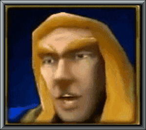
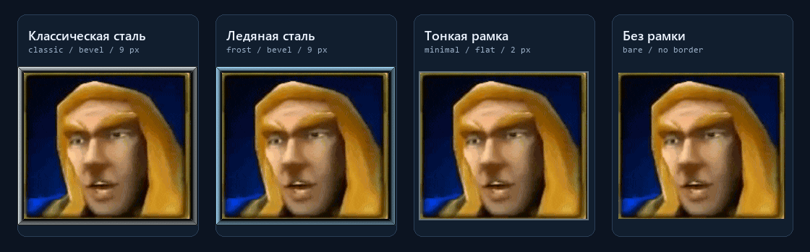

# WinGPT TTS

**WGTTS** — программа для озвучки ответов из Windows-приложения ChatGPT.
Сообщения читаются через Windows UI Automation, звук создаётся через Applio,
а во время воспроизведения на рабочем столе анимируется портрет.

## Озвучка

Есть ручной выбор сообщений и автоматическое чтение новых завершённых ответов.
Голос и его параметры берутся из последней успешной TTS-задачи в Applio.
Воспроизведение можно приостанавливать, продолжать и останавливать.

| Команда | Что происходит |
| --- | --- |
| `applio` | Импорт параметров голоса из Applio |
| `read` | Обновление сообщений текущего чата |
| `list` | Список прочитанных сообщений |
| `say` | Озвучка выбранного ответа |
| `auto on` / `auto off` | Включение и выключение автоозвучки |
| `stop` | Остановка озвучки |

Короткая запись из `data/audio`, 7,28 с:
**[MP3](docs/media/voice-sample.mp3)** ·
[WAV](docs/media/voice-sample.wav) ·
[Видео с аудиодорожкой](docs/media/voice-demo.mp4).

## Виджет и оформления

<p align="center">
  
  <br><sub>Анимация виджета · GIF, без звука</sub>
</p>

Встроенный портрет — Артас. Вместо него может использоваться другой GIF
или статичная картинка. Анимация работает во время воспроизведения;
при паузе и ожидании портрет неподвижен.

Картинка и рамка образуют одно оформление. В нём сохраняются путь к изображению,
стиль, цвет и толщина рамки. Встроенные варианты:



| Пресет | Рамка |
| --- | --- |
| `classic` | Стальная, со скосами |
| `frost` | Та же форма с холодным оттенком |
| `minimal` | Тонкий плоский кант |
| `bare` | Без дополнительной рамки |

Оформление меняется в контекстном меню виджета или командами в консоли.
Собственные сочетания сохраняются как пресеты:

```text
preset frost
set border-color "#7196ad"
set border-width 12
preset save "Мой Артас"
```

Виджет перетаскивается по рабочему столу, масштаб меняется колёсиком.
При наведении появляются кнопки воспроизведения.

## Консоль

Программа занимает отдельный экран в текущем окне терминала.
Результат новой команды заменяет предыдущий, строка ввода остаётся снизу.
При выходе восстанавливается содержимое консоли, которое было до запуска.

| Действие | Клавиши или команда |
| --- | --- |
| История команд | ↑ / ↓ |
| Дополнение команды | Tab |
| Прокрутка результата | PgUp / PgDn, Ctrl+Home / Ctrl+End |
| Справка | `help` или F1 |
| Выход | `quit`, `exit`, Ctrl+C или F10 |

## Запуск

Окружение: **Windows**, **Python 3.11+ с Tcl/Tk**, приложение **ChatGPT**
и настроенный **Applio**. Адрес Applio по умолчанию — `http://127.0.0.1:8000`.

Из папки проекта, в PowerShell:

```powershell
.\wgtts
```

В sh / Git Bash:

```sh
./wgtts
```

Первый запуск создаёт окружение и устанавливает зависимости через интернет.
Следующие запуски используют это окружение.

Параметр `--no-widget` отключает виджет, `--plain` включает обычный текстовый вывод.
После установки пакета также доступны `python -m wgtts` и команда `wgtts`
в активированном окружении.

[Команды и режимы](docs/usage.md) · [Устройство приложения](docs/architecture.md)

<details>
<summary>Структура и проверки</summary>

```text
src/wgtts/
├── chat/       # чтение ChatGPT, история и наблюдение
├── speech/     # API Applio, воспроизведение и очередь
├── ui/         # консоль, виджет и отрисовка портрета
├── assets/     # встроенные изображения
├── cli.py      # параметры запуска
├── settings.py # настройки и оформления
└── paths.py    # ресурсы и каталоги данных

tests/          # тесты
tools/          # диагностика и генерация медиа
docs/           # документация
pyproject.toml  # зависимости и сборка
```

```powershell
.\.venv\Scripts\python.exe -m pip install -e ".[dev]"
.\.venv\Scripts\python.exe -m unittest discover -s tests -v
.\.venv\Scripts\python.exe -m ruff check .
.\.venv\Scripts\python.exe -m ruff format --check .
.\.venv\Scripts\python.exe -m build
```

[Генерация GIF, галереи и звукового примера](docs/media/README.md)

</details>

<details>
<summary>Данные</summary>

В исходном проекте настройки, история и временные записи находятся в `data/`.
Эта папка исключена из Git. При установке wheel данные хранятся
в `%LOCALAPPDATA%\WinGPT TTS`.

Для README один короткий пример отдельно сохранён в `docs/media/`.

Чтение чата зависит от доступных элементов интерфейса ChatGPT и виртуализации
сообщений. Для Edge TTS текст отправляется сервису TTS;
преобразование голоса выполняется в локальном Applio.

</details>
